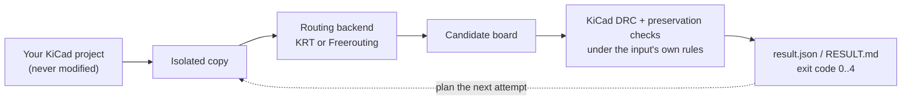

# kicad-route guide

This guide explains kicad-route from the ground up: what it does, how a routing
attempt works, how to read its results, and how to use it for real work. It is
written for someone who knows KiCad but has never seen kicad-route. Each page builds
on the one before it, and the diagrams and figures are meant to be read, not just
glanced at.

The reference pages in [`docs/`](../) remain the source of truth for every option
and field. This guide links to them where the detail matters.

## Reading order

| Page | Read it when you want to |
|---|---|
| [1. Overview](overview.md) | understand what kicad-route is, the one idea behind it, and the promises it keeps |
| [2. Getting started](getting-started.md) | install it, route the bundled demo board, open the result in KiCad |
| [3. How a run works](how-a-run-works.md) | follow an attempt from the command line to the verdict, step by step |
| [4. Reading results](reading-results.md) | make sense of `RESULT.md`, `result.json`, the exit code and the checks |
| [5. Workflows](workflows.md) | route real boards: scopes, chains, campaigns, retries, audits |
| [6. Automation and sandboxes](automation.md) | call kicad-route from a program or an agent, run it offline and read-only |
| [7. Glossary](glossary.md) | look up a term |

## The guide in one picture

kicad-route never routes your project in place, never relaxes a rule to make an
attempt pass, and never trusts a backend's own report. KiCad grades every candidate.

## Reference pages

| Page | Topic |
|---|---|
| [`routing.md`](../routing.md) | design and reference: backends, run layout, grading, preservation, install, decisions, limitations |
| [`interface.md`](../interface.md) | the machine contract: records, schema ids, exit-code promises, refusals |
| [`campaign.md`](../campaign.md) | hard-nets-first campaigns |
| [`blocked.md`](../blocked.md) | blocked-by receipts for open connections |
| [`hygiene.md`](../hygiene.md) | stall watchdog, run ledger, canary, real-board corpus, nothing under HOME |
| [`spokes.md`](../spokes.md) | thermal-spoke corridors |
| [`barrier.md`](../barrier.md) | collision barriers |
| [`provenance.md`](../provenance.md) | `--protect human` and the completion ratchet |
| [`pour.md`](../pour.md) | the pour-integrity check |
| [`floor.md`](../floor.md) | rule high-water mark and declared floor |
| [`decoupling.md`](../decoupling.md) | bypass-capacitor cell audit |
| [`sandbox.md`](../sandbox.md) | running in a sandbox |
| [`../../skills/kicad-route/SKILL.md`](../../skills/kicad-route/SKILL.md) | the agent-facing skill with the retry playbook |

## Figures

The board pictures in this guide are renders of the bundled demo board
(`fixtures/route_demo/`) and of candidates the test suite produced from it. They
live in [`docs/figures/`](../figures/) and are regenerated with
`scripts/render-figures.sh`. Front copper is red, the back-copper ground pour is
blue, and the pre-routed, locked `/SIG_B` track is the white track with two vias.
The white rectangle in the middle is a keepout that forbids copper.
