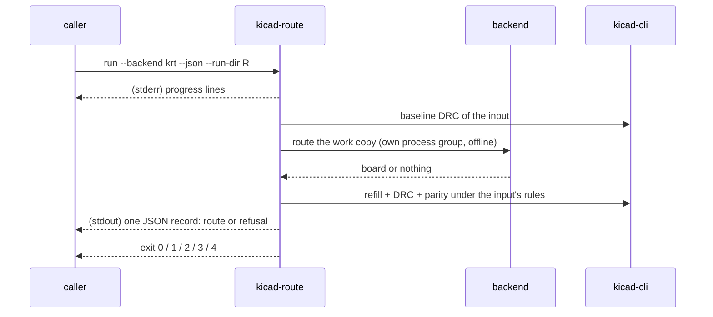
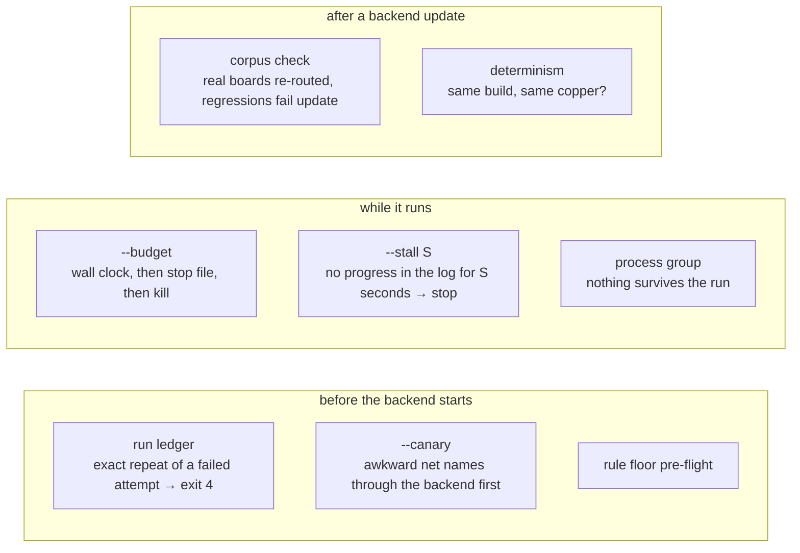
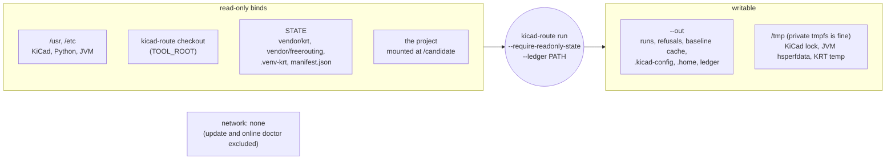
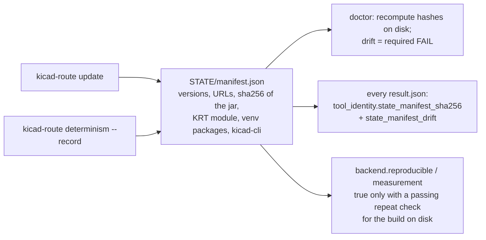

# 6. Automation and sandboxes

kicad-route is built to be driven by programs and agents. This page shows the
machine interface, the guards that keep unattended runs honest, and what a sandbox
has to provide. The contract itself is [interface.md](../interface.md).

## Machine mode: `--json`

```sh
kicad-route run --backend krt --json --run-dir /tmp/r1 > result.json 2> progress.log
echo $?
```

- stdout carries **exactly one JSON object**: the command's record (the same
  content as the file it wrote) or a refusal record.
- all progress lines and every child process's output go to stderr.
- `--run-dir PATH` chooses the run directory (it must not exist), so concurrent
  runs cannot interfere, and no `latest` link is touched.
- options must be spelled in full; `--out` and `--json` go before or after the
  subcommand; nothing ever prompts or reads stdin.



### Records

Every command record carries `"schema": "kicad-route/<kind>/<major>"` and `"kind"`.
With pair evidence, `route` and `route-validate` use `/2` and `result-2.json`;
without it they keep `/1`. `attempt.json` carries `kicad-route/attempt/1` without
the option or `kicad-route/attempt/2` with `--diff-pairs auto` (no `kind` field).
The exact key sets are in [interface.md](../interface.md#attempt-and-result-key-sets).

| `kind` | `schema` | Written to | From |
|---|---|---|---|
| `route` | `kicad-route/route/1` | `<run_dir>/result.json` | `run` |
| `route-validate` | `kicad-route/route-validate/1` | `<run_dir>/revalidate*/<stamp>/result.json` | `validate` |
| `route-campaign` | `kicad-route/route-campaign/1` | `OUT/campaigns/…/campaign.json` | `campaign` |
| `refusal` | `kicad-route/refusal/1` | `OUT/refusals/<stamp>-<pid>.json` | any command |
| blocked-by report | `kicad-route/blocked/2` | `blocked-by.json` | `blocked`, validation |
| `audit`, `floor`, `doctor`, `decoupling`, `barrier-preview` | `kicad-route/<kind>/1` | under `OUT/<kind>/…` | the command of that name |

JSON Schemas for the first four are in [`schemas/`](../../schemas/), and the test
suite validates every committed fixture result against them.

### What the exit code promises

| Exit | The record guarantees |
|---|---|
| 0 | process PASS, validation PASS, routing COMPLETE, a `candidate`, and the board in `candidate/` is the file DRC graded (`candidate_board_sha256 == validated_board_sha256`) |
| 1 | process FAIL with `process.reasons`, `candidate` null; routing and validation NOT_RUN |
| 2 | process PASS, validation PASS, routing INCOMPLETE with `unrouted_nets` and `blocked_by` |
| 3 | process PASS, validation FAIL with non-empty `validation.reasons` |
| 4 | nothing ran: no candidate, no run directory, a refusal record with `reason_class` and `message` |

Exit 1 without a parsable record is a kicad-route bug (an uncaught exception),
never a routing verdict.

### Versioning

Informational additions keep the major version. Pair evidence uses distinct `/2`
ids so callers can bind its key sets while default results keep `/1`.
Removing or redefining a stable field bumps the major, and for at least one release
the old field is written beside the new one and listed under `deprecated`.

## Guards for unattended runs



- **The run ledger** (`OUT/ledger.jsonl`) fingerprints every attempt from the input,
  the backend build and the normalised settings. A repeat of one that failed is
  refused (exit 4) because KRT fails the same way twice; `--force` overrides, and
  a different backend version is allowed with a note. `KICAD_ROUTE_LEDGER=off`
  records but never refuses.
- **`--stall S`** watches the backend's own log for progress (per-net lines, phase
  banners, improving passes) and stops a search that goes nowhere, without waiting
  for the budget. Choose S above the longest silent leg (KiCad refills print
  nothing).
- **Budget overrun** is a known KRT limitation: its late passes ignore the stop
  file, so a blocked board can end in a kill (exit 1). `--backend-env
  KICAD_NET_RESCUE=0` or `KICAD_PLANE_FINALIZE=0` returns a partial candidate
  instead ([hygiene.md](../hygiene.md#budget-overrun)).

## Running in a sandbox

A sandboxed caller gives routing no network, a read-only tool install and project,
and one writable output directory. `doctor --json --offline` prints what such a
sandbox must provide, and every result records what the run actually saw.



```sh
bwrap ... --unshare-net \
  --ro-bind STATE STATE --ro-bind TOOL_ROOT TOOL_ROOT \
  --ro-bind PROJECT /candidate --bind WORK /work --chdir /work \
  --clearenv --setenv HOME /work/home --setenv PATH /usr/local/bin:/usr/bin:/bin -- \
  /usr/bin/env KICAD_ROUTE_STATE=STATE \
  /usr/bin/python3 TOOL_ROOT/bin/kicad-route --out /work/out \
    run --backend krt --dir /candidate --name PROJECT_NAME \
    --require-readonly-state --ledger /work/ledger.jsonl
```

- **`--require-readonly-state`** refuses (exit 4, `state`) unless STATE exists,
  holds a backend, matches its manifest and is not writable. `update` and
  `corpus add` refuse under it, because they write STATE.
- **`--ledger PATH`** keeps the ledger outside a per-stage OUT, so repeat refusal
  survives. Both are *environment* options: `campaign` passes them to every step,
  and a corpus entry never records them.
- **HOME may be read-only.** KiCad's configuration goes to `OUT/.kicad-config`;
  its cache and data, fontconfig and the JVM's `user.home` go under `OUT/.home`.
  The test suite runs the round trips under `strace` with an empty read-only HOME
  and fails on any write attempt outside OUT and `/tmp`.
- `result.json` `sandbox` records the network namespace (`isolated`), STATE's
  writability and the flag, so the evidence shows the run was contained
  ([sandbox.md](../sandbox.md)).

Sandboxed and unsandboxed runs of the same input give the same verdicts,
fingerprints and copper; only UUIDs differ.

## Reproducibility and tool identity

A caller that needs one exact tool build does not ask kicad-route to pin anything
(versions are declared, never pinned). It captures `tool_identity` or
`STATE/manifest.json` once and refuses runs whose identity differs:



`determinism` routes one input repeatedly with the ledger off and compares the
copper signature and the outcome. Byte-identical candidates are not expected: KiCad
assigns fresh UUIDs and KRT's item order varies. Geometric equivalence is the
criterion.

## Exit codes of the other commands

| Command | 0 | 1 | 3 | 4 |
|---|---|---|---|---|
| `campaign` | best chain complete and valid (2: valid but incomplete) | no gradable chain | best chain fails validation | refused |
| `validate` | as `run` | no candidate board to grade | as `run` | refused |
| `audit` | no findings | a revision could not be graded | findings | refused |
| `floor` | nothing below the declared floor | | below it, or a broken floor file | refused |
| `blocked` | receipts written | diagnosis failed | | refused |
| `determinism` | reproducible | `--record` could not store | not reproducible | refused |
| `doctor` | every required check passes | a required check fails | | refused |
| `compare` | same input | inputs differ | | refused |
| `decoupling`, `barrier` | report / preview written | the analysis failed (record carries the reason) | | refused |
| `spokes RUN` | no new `starved_thermal` | | new starved pads | refused |

Next: [Glossary](glossary.md).
