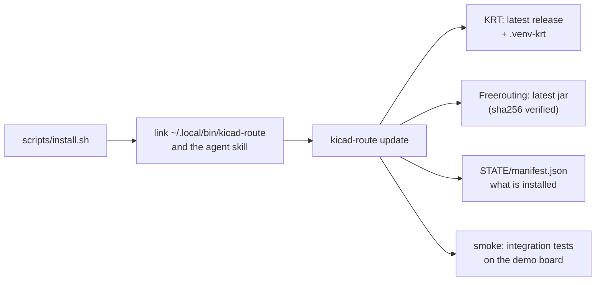
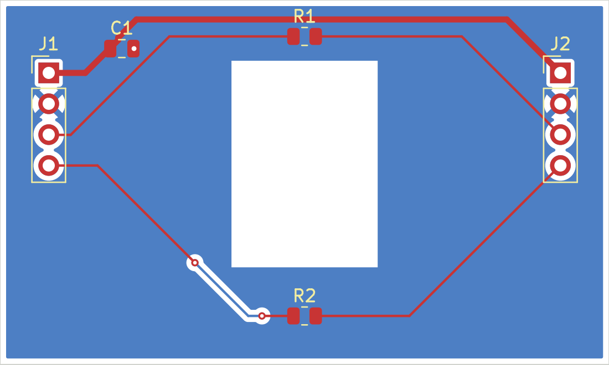
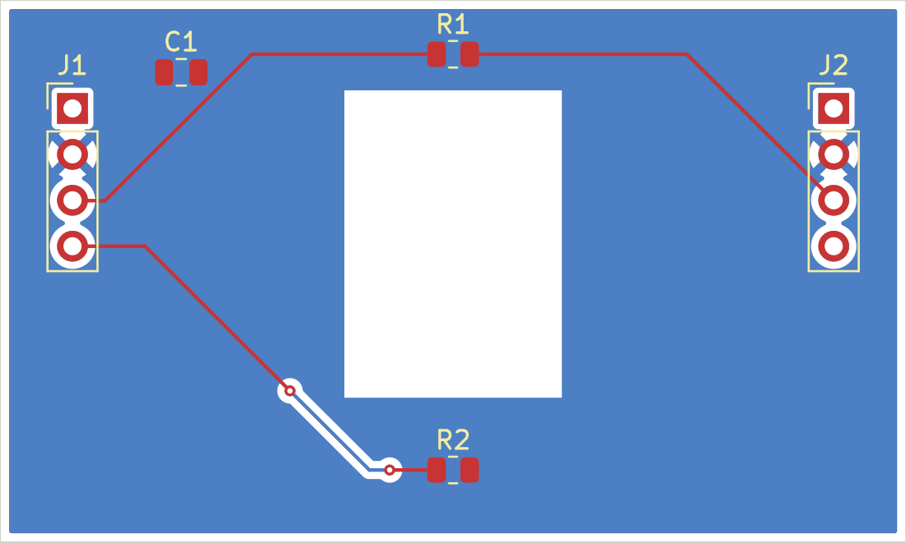
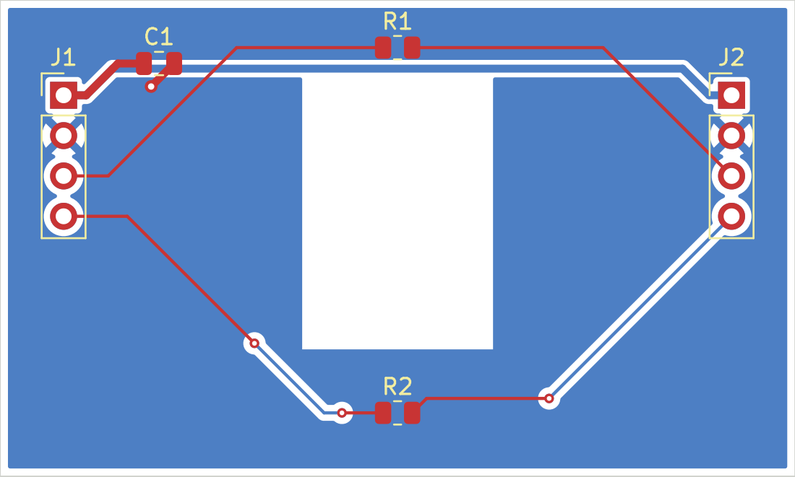

# 2. Getting started

This page takes you from nothing to a graded routing attempt on the bundled demo
board, and shows what you see at each step.

## Install

Requirements: Linux, KiCad 10 with its Python bindings for `/usr/bin/python3`
(`kicad-cli` and `pcbnew`), `git`, [`uv`](https://docs.astral.sh/uv/), and a Java
runtime new enough for the current Freerouting jar (Java 25 for 2.5.x).

```sh
git clone https://github.com/halbritt/kicad-route ~/git/kicad-route
~/git/kicad-route/scripts/install.sh      # links the CLI and the agent skill, then runs `kicad-route update`
kicad-route doctor
```

`install.sh` links `~/.local/bin/kicad-route` and installs both backends at their
latest upstream releases. Nothing is pinned: the versions in use are recorded in
every result instead ([routing.md](../routing.md#installation-and-updates)).



`kicad-route doctor` reports readiness: KiCad and backend versions, whether the
installed files still match the manifest, and whether the awkward-net-name canary
passes. Fix anything it marks as a required failure before routing.

## Route the demo board

Copy the demo project somewhere writable and route it. (The copy is only so that
the output directory lands beside a project you own; kicad-route never writes into
the project itself.)

```sh
cp -r ~/git/kicad-route/fixtures/route_demo /tmp/route_demo
cd /tmp/route_demo
kicad-route run --backend krt --budget 120 --default-clearance 0.4
```

The console shows each stage as it happens:

```
[route] krt on route_demo -> build/kicad-route/runs/route_demo/krt/20261018T145739.829486Z
[route] scope: all (6 of 6 nets)
[route] baseline: native DRC of the untouched input (refilled)
[route] routing with krt (budget 120s)
[route] process: PASS
[route] validating the candidate (refill, DRC + parity, preservation)
[route] routing: COMPLETE
[route] validation: PASS
[route] candidate: build/kicad-route/runs/route_demo/krt/20261018T145739.829486Z/candidate/route_demo/route_demo.kicad_pcb
[route] result: build/kicad-route/runs/route_demo/krt/20261018T145739.829486Z/result.json  (exit 0)
```

Exit 0 means **complete and valid**: every in-scope connection is routed, KiCad's
DRC found nothing new, and every preservation check passed.

## Look at the candidate

Open the candidate in KiCad:

```sh
pcbnew build/kicad-route/runs/route_demo/krt/latest/candidate/route_demo/route_demo.kicad_pcb
```

| Before | After |
|---|---|
|  |  |

The candidate directory is a complete copy of the project with the routed board in
it, zones refilled and saved. It is exactly the file KiCad graded. The original in
`/tmp/route_demo` is untouched: compare the two with `diff -r` if you like.

## Read the verdict

`RESULT.md` in the run directory is the human-readable verdict. The top of it:

```
# Routing attempt: krt on route_demo

- Backend: krt 0.23.1 (v0.23.1)
- Input: `route_demo.kicad_pcb` from working tree @ None (fingerprint ba2f343c49e2f971)
- Scope: all, 6 nets; protect: existing; budget 120 s
- Candidate: `build/kicad-route/runs/route_demo/krt/20261018T145739.829486Z/candidate/route_demo/route_demo.kicad_pcb`

| Result | Status | Detail |
|---|---|---|
| process | PASS | exit 0, 9.105 s |
| routing | COMPLETE | 0 unconnected in scope, 0 total (input: 6) |
| validation | PASS | no new findings |

| Preservation check | Status |
|---|---|
| project_files | PASS |
| board_outline | PASS |
| ...
| pour_integrity | PASS |
```

Three independent results, always in this order: did the backend run (**process**),
is everything connected (**routing**), and is the board acceptable (**validation**).
`result.json` beside it has the same content for programs. [Reading results](reading-results.md)
explains every field.

## A second attempt: watch a rule being enforced

The demo project has a custom rule in `route_demo.kicad_dru`: Power nets must keep
0.4 mm from everything that is not Power. KRT cannot read that kind of rule, so
without `--default-clearance 0.4` it routes `/SIG_A` 0.3748 mm from a ground pad.
Run it again without the option:

```sh
kicad-route run --backend krt --budget 120
```

```
[route] routing: COMPLETE
[route] validation: FAIL (1 new DRC violations: clearance 1)
[route] result: build/kicad-route/runs/route_demo/krt/20261018T145810.667194Z/result.json  (exit 3)
```

Exit 3: **fails validation**. The routing is complete, but KiCad's DRC, under the
project's own rules, found a violation the backend could not see. kicad-route did
not relax the rule and did not hide the problem. `RESULT.md` lists the rule under
"Unsupported or approximated by this backend", and
`validate/new-findings.json` names the track and the pad:

```json
{"description": "Clearance violation (rule 'power_to_signal_clearance' clearance 0.4000 mm; actual 0.3748 mm)",
 "items": [{"description": "Track [/SIG_A] on F.Cu, length 11.4551 mm", "pos": {"x": 113.7, "y": 103.0}},
           {"description": "Pad 2 [GND] of C1 on F.Cu", "pos": {"x": 110.95, "y": 104.0}}],
 "severity": "error", "type": "clearance"}
```

The fix is the tightening option you used the first time: `--default-clearance 0.4`
makes the Default class as strict as the custom rule, so the backend keeps its
distance. Tightening is always allowed; relaxing never is.

## Compare attempts

```sh
kicad-route compare build/kicad-route/runs/route_demo/krt/2026*Z
```

```
| fp | backend | exit | routing | unconnected | validation | new_violations | new_vias | new_length_mm | backend_s | run |
|---|---|---|---|---|---|---|---|---|---|---|
| d4d68e21a5b0 | krt 0.23.1 | 0 | COMPLETE | 0 | PASS | 0 | 1 | 117.987 | 9.105 | build/kicad-route/runs/route_demo/krt/20261018T145739.829486Z |
| a29dca227d25 | krt 0.23.1 | 3 | COMPLETE | 0 | FAIL | 1 | 1 | 117.87 | 10.463 | build/kicad-route/runs/route_demo/krt/20261018T145810.667194Z |
```

`compare` refuses to put runs of different inputs side by side, so the table is
always apples to apples. The `fp` column is the attempt fingerprint the run ledger
uses (see below).

## Route only some nets

```sh
kicad-route run --backend krt --nets '/SIG_A*' --default-clearance 0.4
```



Only `/SIG_A` and `/SIG_A_OUT` were routed; `/VIN` and the others are still open,
and the run is still exit 0, because the verdict is about the **scope** you asked
for. The `routing_scope` preservation check makes sure no copper appeared on nets
outside it.

## Try the other backend

```sh
kicad-route run --backend freerouting --clearance-margin 0.01
```



Freerouting takes a different path and uses the back layer for part of `/VIN`.
`--clearance-margin 0.01` adds 10 µm to every clearance it is given, because it
approximates pad shapes and can land a few micrometres inside a rule.

## Things to know on day one

- **Where runs go.** `./build/kicad-route/runs/<project>/<label>/<stamp>/`, with a
  `latest` link per label. Change the root with `--out DIR` or `$KICAD_ROUTE_OUT`;
  pick the directory yourself with `run --run-dir PATH`.
- **The run ledger.** An exact repeat of an attempt that already failed is refused
  with exit 4, because KRT would fail the same way again. Change something (scope,
  budget, an option) or pass `--force`. The ledger is `build/kicad-route/ledger.jsonl`.
- **Budget.** `--budget SECONDS` is wall clock (default 300). KRT is stopped
  cleanly at the budget when it can be, and killed after a grace period when it
  cannot.
- **The project file must match the board's name.** KiCad only loads
  `main.kicad_pro` and `main.kicad_dru` for `main.kicad_pcb`. A board without a
  same-name project file is refused (exit 4) rather than graded under KiCad's
  defaults.
- **The verdict is the exit code.** 0 complete and valid, 1 the backend failed,
  2 valid but incomplete, 3 fails validation, 4 refused before routing.

Next: [How a run works](how-a-run-works.md).
