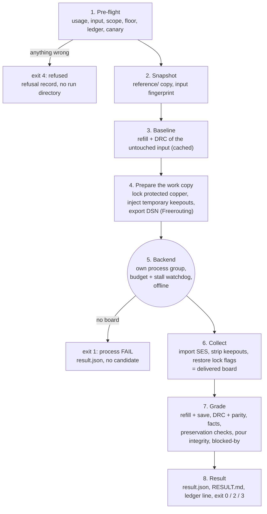
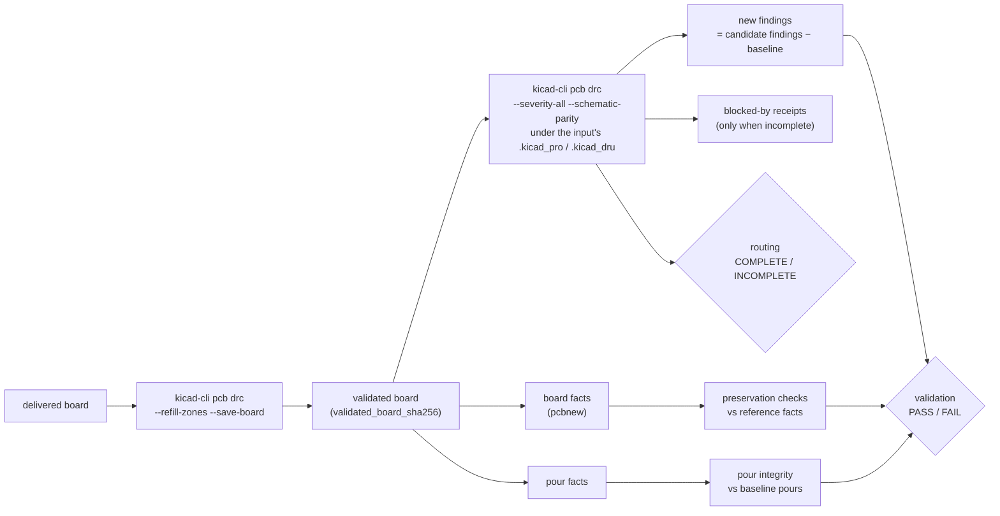

# 3. How a run works

`kicad-route run` is a pipeline of eight stages. Knowing them makes every file in
the run directory and every field in the result obvious.



## 1. Pre-flight: refuse rather than guess

Before anything is written, the command line and the input are checked. Any
problem is a **refusal**: exit 4, a refusal record under `OUT/refusals/`, and no
run directory left behind. A refusal is never a routing verdict.

| Refusal class | Examples |
|---|---|
| `usage` | an unknown or abbreviated option, a bad value, `--json` on a command without machine mode |
| `input` | not exactly one board in the directory, a bad `--rev`, a board without a `.kicad_pro` of its own name, a net selection that matches nothing |
| `ledger` | this exact attempt (same input, backend build and settings) already failed |
| `canary` | `--canary` was given and the awkward-net-name pre-flight failed |
| `state` | `--run-dir` exists; or under `--require-readonly-state` the state directory is writable or has drifted from its manifest |

The declared rule floor is also read here (`<board>.rules-floor.json`). An input
below its floor still routes, but validation will fail and name the setting and its
owner ([floor.md](../floor.md)).

## 2. Snapshot: the reference copy

The project is copied into `reference/<project>/`: the board, `.kicad_pro`,
`.kicad_dru`, every reachable schematic sheet, the library tables and local
libraries. Libraries reached through `${KIPRJMOD}/../<dir>` are linked beside the
copy. With `--rev REV` the snapshot comes from `git archive` of that commit, so
other people editing the working tree cannot change what you routed.

The **input fingerprint** is a hash over every reference file. It identifies the
input in the ledger, in `compare`, and in chains. `snapshot.json` records what was
copied and linked.

## 3. Baseline: what was already wrong

The untouched input is refilled and graded the same way the candidate will be, and
the report is cached under `OUT/.cache/baseline/<fingerprint>/`. Later, a
candidate finding counts as **new** only if the same type, severity and items do
not exist in the baseline. Pre-existing problems are reported but never fail an
attempt. Pour facts of the refilled input are cached beside it for the
pour-integrity check.

## 4. Prepare the work copy

`work/input/` is what the backend sees. Depending on the options:

| Option | What is done to the work copy |
|---|---|
| `--protect existing` (default) | every input track and via is locked, so the backend cannot touch it (`work/locks.json` remembers the original flags) |
| `--protect locked` | only copper that is locked in the design is protected |
| `--protect human` | in a chain, only the designer's copper is locked; copper from earlier kicad-route steps may be rerouted ([provenance.md](../provenance.md)) |
| `--reserve-spokes [N]` | temporary single-layer keepouts over thermal-spoke corridors ([spokes.md](../spokes.md)) |
| `--barrier-from RUN` | temporary small keepouts where that run's new copper collided ([barrier.md](../barrier.md)) |
| `--backend freerouting` | the board is exported to Specctra DSN; out-of-scope nets are moved to `__skip` classes so Freerouting ignores them; net names KiCad writes inconsistently are respelled |

None of these changes a rule. They only take routing room away from the backend,
and the temporary keepouts are removed again before grading.

## 5. The backend runs

The backend starts as the leader of its own session and process group, with:

- a **wall-clock budget** (`--budget`, default 300 s). KRT is asked to stop through
  its stop file; after a grace period of `max(30, budget/5)` s the whole group is
  terminated, then killed.
- an optional **stall watchdog** (`--stall S`): the log is tailed for progress, and
  a backend that makes none for S seconds is stopped the same way.
- **no network**: Freerouting's update check is pointed at a dead proxy.
- **nothing under HOME**: KiCad's and the JVM's per-user files go under `OUT/.home`
  and `OUT/.kicad-config`.
- every relaxation the backend offers switched off ([routing.md](../routing.md#what-the-adapters-switch-off)).

A backend that returns no board is a **process failure**: exit 1, a `result.json`
whose `process.status` is FAIL with reasons, and no candidate. Heartbeats
(`work/heartbeat.jsonl`) and `process.last_phase` say how far it got.

## 6. Collect: the delivered board

The backend's output is brought back into a KiCad board: KRT's output file
directly, Freerouting's session through KiCad's SES import (with the footprint
placement section removed, so a session can never move parts). Temporary keepouts
are stripped, lock flags are restored to what the design had, and the result is
the **delivered board**: `delivered_board_sha256`.

## 7. Grade

This is where the verdict is made, and nothing the backend said is used for it.



- **Refill and save.** Zones are refilled and the board is saved; that saved file
  is the one DRC reads and the one you get in `candidate/`.
- **DRC with parity** under the input's own project files, byte for byte. If the
  backend changed a project file, the input's version is restored first and the
  attempt fails `project_files`.
- **Routing status** comes from KiCad's unconnected items on in-scope nets after
  the refill, not from the backend's count.
- **Preservation checks** compare board facts of the reference and the candidate:
  outline, layers, stackup, setup, nets and classes, pad connectivity, footprints,
  zones, keepouts, copper graphics, protected copper, new copper geometry, routing
  scope, net completion, pour integrity. The full table is in
  [reading-results.md](reading-results.md#preservation-checks).
- **Blocked-by receipts** are computed when routing is incomplete: what lies
  across each open connection ([blocked.md](../blocked.md)).

## 8. Result

`result.json` and `RESULT.md` are written, the attempt is appended to the ledger,
and the exit code is chosen in a fixed order: process failure (1) beats validation
failure (3), which beats incomplete routing (2); otherwise 0.

### Three board hashes

| Hash | The board… | Differs from the previous one when |
|---|---|---|
| `delivered_board_sha256` | as the backend handed it back (after lock restore and keepout strip) | |
| `validated_board_sha256` | after refill and save: the file DRC read | the refill changed the file (`refill_modified_board`, always true for Freerouting) |
| `candidate_board_sha256` | in `candidate/` after grading | never on exit 0: the contract promises it equals the validated one |

### The run directory

```
OUT/runs/<project>/<label>/<stamp>/
├── reference/<project>/        untouched copy of the input project
├── work/                       what the backend saw and wrote
│   ├── input/<project>/          the locked work copy
│   ├── krt.log | freerouting.log, board.dsn / board.ses
│   ├── heartbeat.jsonl           progress heartbeats for the stall watchdog
│   └── locks.json                original lock flags, restored afterwards
├── candidate/<project>/        the routed, refilled board that was graded
├── facts/reference-facts.json  engineering facts of the input board
├── validate/
│   ├── candidate-drc.json        native DRC of the candidate
│   ├── new-findings.json         findings new relative to the baseline
│   ├── preservation.json         every preservation check with details
│   ├── candidate-facts.json      facts of the candidate
│   ├── candidate-pour.json, pour-integrity.json
│   └── blocked-by.json           only when routing is INCOMPLETE
├── attempt.json                input identity, scope, settings (what validate re-reads)
├── snapshot.json               what was copied and linked
├── result.json                 the verdict for programs (schema kicad-route/route/1)
└── RESULT.md                   the verdict for people
```

`OUT/runs/<project>/<label>/latest` points at the newest run with that label.
`OUT/ledger.jsonl`, `OUT/refusals/`, `OUT/.cache/baseline/` and
`OUT/.kicad-config` live beside the runs.

## Re-grading: `validate`

`kicad-route validate RUN_DIR` repeats stage 7 on an existing candidate, for
example after you edited it by hand, and writes into `RUN_DIR/revalidate/<stamp>/`.
It reads the attempt's settings from `attempt.json`, so the scope and protection
are the same as the original run. `validate LAST --against FIRST` grades the end
of a chain against the first run's input ([workflows.md](workflows.md#chains)).

Next: [Reading results](reading-results.md).
