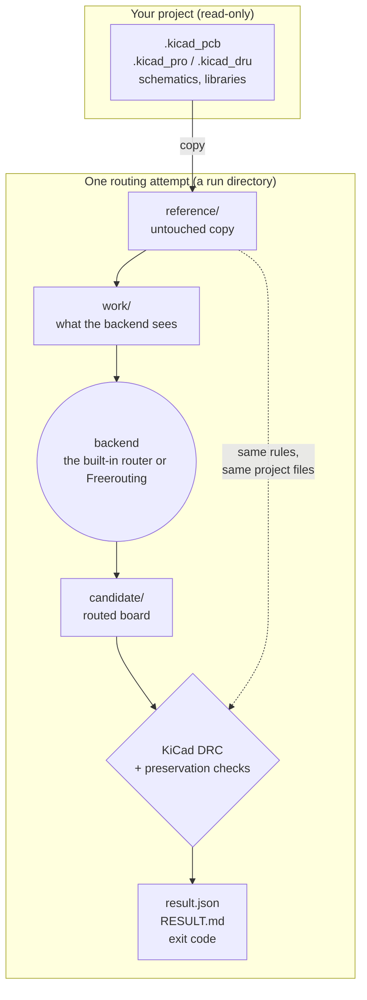
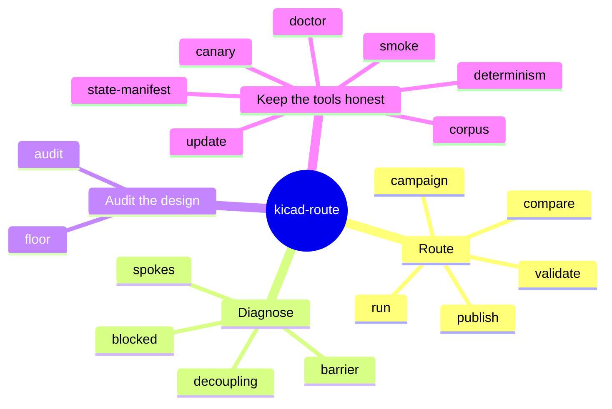

# 1. Overview

kicad-route is a command-line tool that routes the traces of a KiCad printed
circuit board for you, using one of two open-source autorouters, and then tells you
honestly whether the result is any good. It was built so that an AI agent (or a
person in a hurry) can try routing attempts over and over without ever damaging the
design or fooling itself about the outcome.

## The one idea

Autorouters are useful but not trustworthy. They relax rules to finish, report
success in their own terms, and sometimes move things they should not touch.
kicad-route puts a wall between the autorouter and your design:

1. **The project is copied.** The backend only ever sees the copy. Your files are
   never written.
2. **The backend routes the copy** with every relaxation switched off that can be
   switched off.
3. **KiCad grades the candidate** with its own design rule check (DRC), zones
   refilled, schematic parity on, under the input's own, unchanged project files.
4. **Preservation checks** confirm the backend touched nothing it must not: outline,
   layers, stackup, net classes, footprints, zones, keepouts, existing copper,
   net-class widths, pour integrity.
5. **The verdict is structured**: three independent statuses and an exit code that
   a program can branch on.

## Before and after

The bundled demo board is a 2-layer, 50 x 30 mm board with two connectors, three
passives, a locked pre-routed signal, a ground pour on the back, a custom clearance
rule and a keepout in the middle.

| Input (6 connections open) | Historical candidate: complete and valid (exit 0) |
|---|---|
|  |  |

The figures retain a historical KRT fixture run from before the backend rename.

The thick red track is the Power-class net `/VIN` (0.5 mm). The thin red tracks are
Default-class signals (0.2 mm). The white track with two vias is `/SIG_B`, which was
already routed and locked in the input; the backend was not allowed to touch it, and
the grading confirmed it did not.

## The promises

These hold for every command and are enforced by the test suite:

| Promise | What it means in practice |
|---|---|
| **Never modify in place** | Every attempt routes a copy under an output directory (`--out`, default `./build/kicad-route`). The project directory is byte-identical afterwards. |
| **Never relax a rule** | No option lowers a clearance, narrows a width, changes a severity or edits a keepout. Options can only tighten (for example `--default-clearance`). |
| **KiCad decides** | The verdict comes from `kicad-cli pcb drc` under the input's own `.kicad_pro` and `.kicad_dru`. Backend self-reports are kept as diagnostics only. |
| **Builds are declared** | The owned engine is built from this repository; Freerouting is acquired separately. Every result records the build, source and runtime identity. |
| **Fail closed** | Anything that cannot be checked counts as a failure. Anything wrong with the command or the input is refused before routing starts (exit 4). |
| **Never interactive, never online during an attempt** | No prompts, no stdin. Only `update` and the online `doctor` checks use the network. |

## Two backends, one command

The built-in router is maintained in kicad-route's own source, derived from KRT
(KiCadRoutingTools). It needs no separate KRT checkout. Use `--backend builtin`;
`--backend krt` is a deprecated alias that warns on stderr. Historical receipts and
compatibility state keys retain `krt`.

| | Built-in router (`builtin`) | Freerouting |
|---|---|---|
| How it talks to KiCad | reads and writes `.kicad_pcb` directly | through KiCad's Specctra DSN/SES bridge |
| Determinism | deterministic for a given build: a result is a **measurement** | varies between runs: a result is an **attempt** |
| Default? | yes (`--backend builtin`) | `--backend freerouting` |
| Typical use | first choice; chains and campaigns | a second opinion when the built-in router is stuck |

Both run as separate processes, offline, inside their own process group, with a
wall-clock budget. Details of what each adapter switches off are in
[`routing.md`](../routing.md#what-the-adapters-switch-off).

## The toolbox

Everything is a subcommand of `kicad-route`. Grouped by purpose:

| Group | Commands | Purpose |
|---|---|---|
| Route | `run`, `campaign`, `validate`, `compare`, `publish` | make attempts, re-grade them, compare them, archive their evidence |
| Diagnose | `blocked`, `spokes`, `barrier`, `decoupling` | understand why an attempt fell short, and what the next one should do |
| Audit the design | `audit`, `floor` | grade a committed board change, and watch for rules quietly loosened over time |
| Keep the tools honest | `doctor`, `update`, `state-manifest`, `determinism`, `canary`, `corpus`, `smoke` | readiness, upgrades, reproducibility, regression gates |

## Who uses it

- **A person** runs `kicad-route run`, opens `candidate/<project>/<board>.kicad_pcb`
  in KiCad, reads `RESULT.md`, and adopts the candidate or tries again.
- **An agent** does the same through the [`kicad-route` skill](../../skills/kicad-route/SKILL.md),
  which includes a retry playbook keyed on the evidence in the result.
- **A program** (for example a board generator) calls it with `--json`, reads one
  JSON record from stdout, and branches on the exit code
  ([automation](automation.md)).

Next: [Getting started](getting-started.md).
