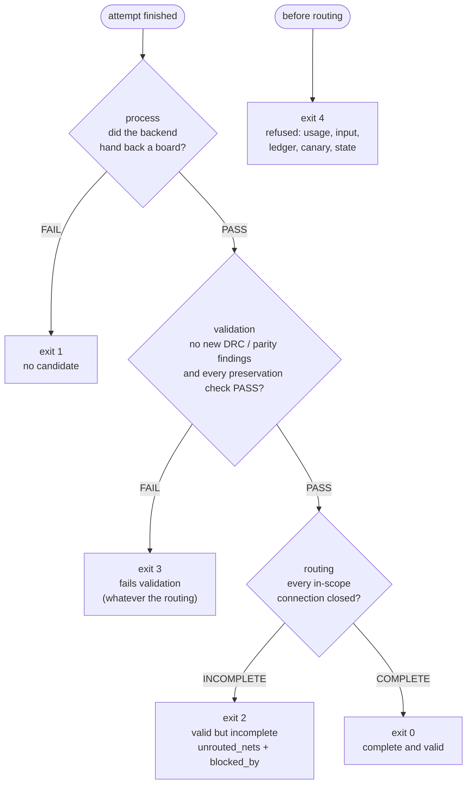
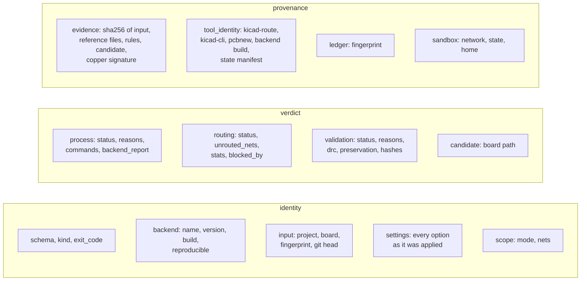
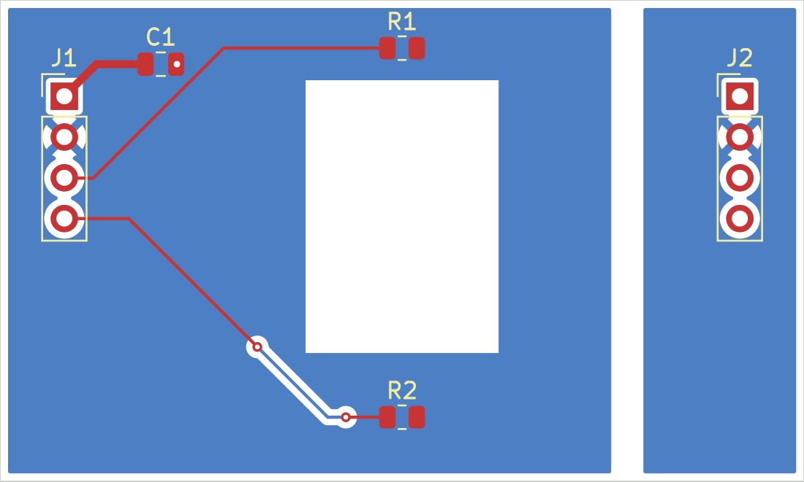

# 4. Reading results

Every attempt ends in the same three places: an exit code, `RESULT.md` for people,
and `result.json` for programs. They all say the same thing. This page explains how
to read them and what to do with what you find.

## Three statuses, one exit code



| Field | Values | Question it answers |
|---|---|---|
| `process.status` | PASS / FAIL | Did the backend run and return a board? `process.reasons` says why not. |
| `routing.status` | COMPLETE / INCOMPLETE / NOT_RUN | Are all in-scope connections closed, by KiCad's count after zone refill? |
| `validation.status` | PASS / FAIL / NOT_RUN | Nothing new in DRC or parity, and every preservation check passes? |

Rules of thumb:

- **Exit 0 is the only "adopt it" signal.** Everything else needs a decision.
- **Exit 2 is good news with a to-do list.** The copper that exists is clean;
  some connections are still open. Read `unrouted_nets` and `blocked_by`.
- **Exit 3 means "do not adopt", not "the router is bad".** Often it is a rule the
  backend could not see (`unsupported`) and a tightening option fixes it.
- **Exit 1 and exit 4 are not verdicts about the board.** The backend did not
  finish, or nothing ran at all.

## RESULT.md, section by section

This captured example predates the `builtin` name. New results identify the
built-in router as `builtin`; historical `krt` receipts remain readable.

```
# Routing attempt: krt on route_demo
- Backend: krt 0.23.1 (v0.23.1)                 ← exactly which build ran
- Input: route_demo.kicad_pcb from working tree @ c45a2db… (fingerprint ba2f343c…)
- Scope: all, 6 nets; protect: existing; budget 180 s
- Candidate: runs/…/candidate/route_demo/route_demo.kicad_pcb

| Result | Status | Detail |                    ← the three statuses
| process | PASS | exit 0, 30.834 s |
| routing | COMPLETE | 0 unconnected in scope, 0 total (input: 6) |
| validation | PASS | no new findings |

| Preservation check | Status |                 ← sixteen checks, all must PASS
| project_files | PASS |
| …

Native DRC (original rules and severities):   ← counts: total, new, pre-existing, resolved

Unsupported or approximated by this backend:  ← constraints the backend could not see;
                                                 KiCad graded them anyway

Route statistics:                              ← new tracks, vias, length per layer
```

When routing is INCOMPLETE there is also a "Blocked by" table, and when validation
FAILs the reasons are listed first.

## result.json, the map



The fields a program may rely on for the whole major version are listed in
[interface.md](../interface.md#stable-and-informational-fields). Everything else
is informational and may change.

## New findings

When validation fails on DRC, look in this order:

1. `validation.reasons`: one line per cause, for example
   `1 new DRC violations: clearance 1`.
2. `validation.drc.new_violations.by_type`: counts per DRC type.
3. `validate/new-findings.json`: each new violation with its items and positions.
   Pre-existing input findings are not in this file.
4. `unsupported`: if the violated rule is listed here, the backend never saw it.
   Tighten the backend's own setting to match (`--default-clearance`,
   `--clearance-margin`).

Schematic parity is part of the same grading. "Failed to fetch schematic netlist"
is itself a validation failure: a run that could not check parity is not valid.

## Preservation checks

Sixteen checks compare board facts of the reference and the candidate. Grouped by
what they protect:

| Group | Check | Fails when |
|---|---|---|
| The design | `project_files` | a `.kicad_pro`, `.kicad_dru`, schematic, library table or local library differs in bytes |
| | `board_outline` | any Edge.Cuts shape changed |
| | `layers`, `stackup`, `board_setup` | copper layers, stackup or the board's setup block changed (or cannot be read: fail closed) |
| | `nets_and_netclasses`, `pad_connectivity` | a net, its effective class, or a pad's net changed |
| | `footprints` | a footprint moved, turned, flipped, changed lock or pad geometry (`changed` names the attributes) |
| | `zones`, `keepouts` | a zone's outline or settings, or a rule area, changed |
| | `copper_graphics` | copper text, shapes or other non-track copper changed |
| New and old copper | `protected_copper` | a designated track or via is missing, moved, or lost its lock flag |
| | `new_copper_netclass_geometry` | a new track is narrower than its class, or a new via smaller than its class |
| | `routing_scope` | new copper appeared on a net outside the scope (or on no net) |
| | `net_completion` | an originally joined set of terminal pads is split, or complete native evidence is unavailable (the ratchet) |
| | `existing_unlocked_copper` | never (informational): how much unlocked input copper changed under `--protect locked` or `human` |
| Pours | `pour_integrity` | a zone-connected pad lost fill contact or the zone's reach, dropped below the minimum spoke count, or ended up on an island cut off from its net's main pour ([pour.md](../pour.md)) |

`validate/preservation.json` has the details of every check, including the
differences that were found.

## Blocked by: what is in the way

When routing is INCOMPLETE, `routing.blocked_by` says which obstacles lie across
the straight and L-shaped corridors between the endpoints of each open connection,
and ranks them.



On this variant of the demo board a keepout wall separates J2 from the rest. The
summary names it as the top blocker of every open net:

```json
"top": [
  {"id": "rule_area:wall", "category": "keepout",
   "label": "keepout 'wall' (no tracks, no vias, no zone fills) on B.Cu, F.Cu",
   "blocks": 4, "nets_blocked": ["/SIG_A_OUT", "/SIG_B_OUT", "/VIN", "GND"]},
  ...
]
```

| Category | Meaning | Next attempt |
|---|---|---|
| `keepout` | a rule area of the design | a design constraint: report it, never edit it |
| `input_copper` | the input's own copper | if unlocked, `--protect locked` lets the built-in router move it; if locked, ask the owner |
| `new_copper` | copper the backend placed in this attempt | route the blocked nets first (`--nets`) on the original input, or use `campaign` |
| `footprint` | other nets' pads | placement is fixed: another layer or approach |
| `board_edge` | a corridor leaves the outline | the connection needs a detour |

It is a heuristic (`heuristic: true`): a pointer for the next attempt, not a
routability proof. The full receipts, with endpoints resolved to footprint and pad,
are in `validate/blocked-by.json` ([blocked.md](../blocked.md)).

## Backend reports and `unsupported`

- `unsupported` lists the constraints the backend could not see or approximated,
  for example a custom `.kicad_dru` rule with a net-class condition. KiCad still
  graded them.
- `process.backend_report` keeps the backend's own view (the built-in router's relaxation ledger
  and summaries, Freerouting's incomplete count). It is a diagnostic. Backends
  disagree with KiCad in both directions, so it never decides anything.

## Provenance: recording a run as evidence

`result.json` carries two blocks so that a run can be cited without re-hashing
its directory:

- `evidence`: sha256 of the input board, every reference file, the rules files,
  the declared floor, the backend's output board, the delivered candidate, and the
  grading records; plus `candidate_copper_signature`, a digest of the candidate's
  tracks, arcs and vias without UUIDs or order. **Compare candidates by that
  signature, not by file hash**: KiCad writes fresh UUIDs on every save.
- `tool_identity`: kicad-route's commit, kicad-cli's version and sha256, pcbnew,
  Python, the backend build (the built-in router's source commit and extension module, or Freerouting jar
  and Java), and the state manifest's sha256 with any drift.

`backend.reproducible` and `measurement` say whether a result is evidence of what
a board can achieve. Freerouting results are attempts (`measurement: false`). A built-in router
result is a measurement only when the state manifest holds a passing repeat check
for its executed build (`kicad-route determinism`) and the current attempt finished
without a budget or stall stop. `measurement_basis` explains that qualification.

## Refusals (exit 4)

A refusal leaves no run directory. The reason is in
`OUT/refusals/refusal-latest.json` (and on stdout with `--json`):

```json
{"schema": "kicad-route/refusal/1", "kind": "refusal", "exit_code": 4,
 "command": "run", "reason_class": "input",
 "message": "the net selection matches no nets",
 "argv": ["run", "--backend", "builtin", "--nets", "NOPE*"], "cwd": "/work/board",
 "input_fingerprint": "3f5c…", "discarded_run_dir": "build/kicad-route/runs/board/builtin/…",
 "refused_utc": "2026-10-17T21:52:53+00:00"}
```

Fix the command or the input and run again. A refusal says nothing about the
board's routability.

Next: [Workflows](workflows.md).
