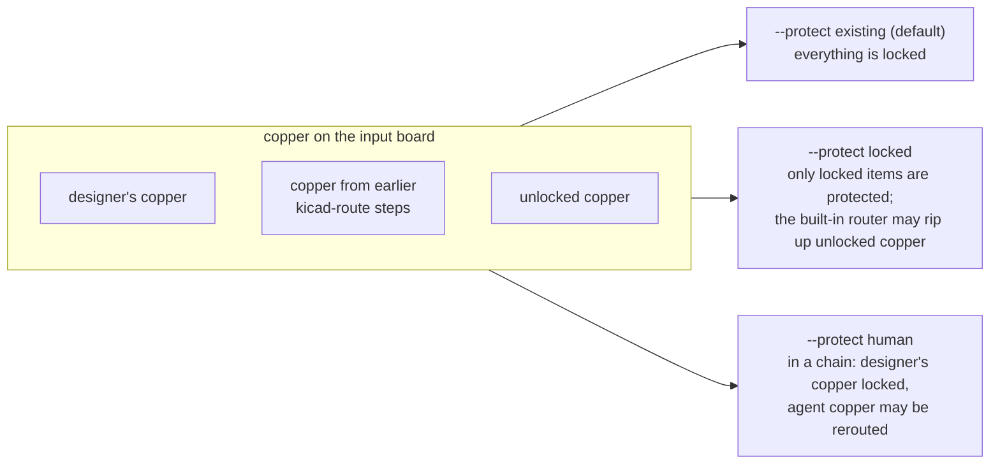
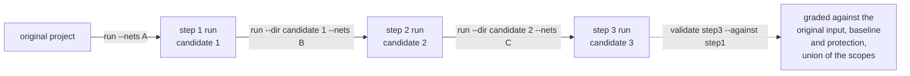
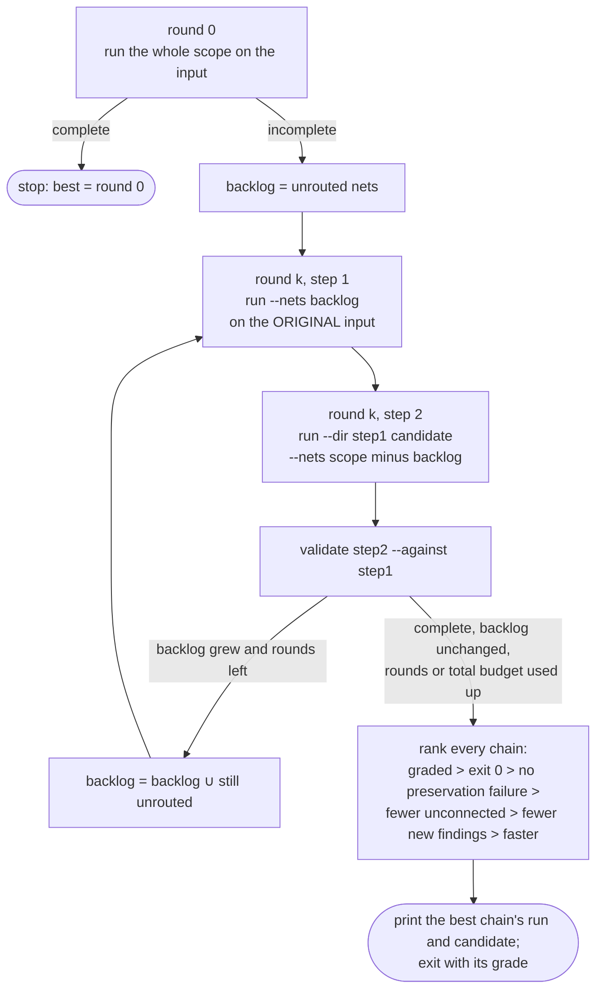
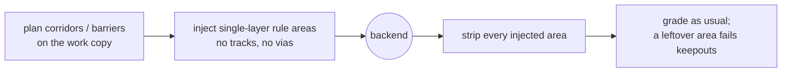
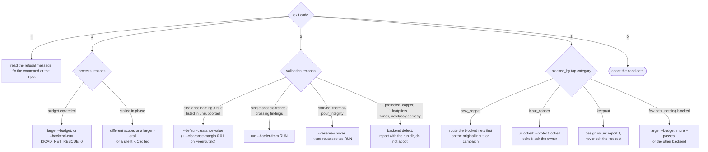
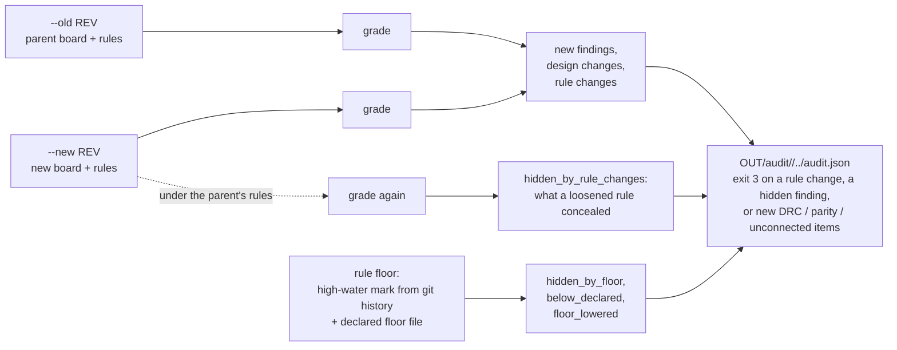

# 5. Workflows

Routing a real board is rarely one command. This page covers the patterns that
work: choosing a scope, tightening, chaining steps, letting a campaign do the
chaining, reading the evidence to choose the next attempt, and auditing what
others committed.

## Choosing what to route

```sh
kicad-route run --backend builtin                               # every net
kicad-route run --backend builtin --nets '/CAN*' '/USB*'        # by name (fnmatch patterns)
kicad-route run --backend builtin --netclass Power               # by effective KiCad net class
kicad-route run --backend builtin --nets '!GND'                  # everything except GND
kicad-route run --backend builtin --nets '\!RESET'               # a net literally named !RESET
```

Exclusions (`!PAT`) apply last, so `--netclass Power --nets '!/VIN'` is "Power
minus /VIN". A selection that matches nothing, or that would silently mean
something else, is refused. New copper on nets outside the scope fails
`routing_scope`.

## Tightening, never relaxing

| Option | Effect |
|---|---|
| `--default-clearance MM` | the Default class clearance the backend works to (the built-in router's `--clearance`, Freerouting's default class). Use the value of a custom rule the backend cannot see |
| `--clearance-margin MM` | Freerouting only: added to every clearance, for the few-micrometre misses its pad approximation causes |
| `--pour-min-spokes N`, `--pour-area-loss PCT` | make `pour_integrity` stricter |
| `--backend-arg ARG`, `--backend-env KEY=VALUE` | pass anything through to the backend; recorded in the result; grading unchanged |

A relaxing option passed through `--backend-arg` does not change the verdict. It
can only make the candidate fail.

## Protecting existing copper



Whichever mode you choose, `protected_copper` checks that every designated item
survived with the same geometry and lock flag, and `net_completion` checks that no
net which was connected in the input is open in the candidate. With `--protect
human`, provenance is derived from the chain of run directories, and anything that
cannot be traced to a kicad-route step counts as human and is locked
([provenance.md](../provenance.md)).

## Chains

Route in steps by starting the next step from the previous candidate. Each step is
graded against its own input, so the chain's end must be graded against the
original with `validate --against`.



```sh
kicad-route run --backend builtin --nets '/CAN*' --label step1
kicad-route run --backend builtin --nets '!/CAN*' --label step2 \
    --dir build/kicad-route/runs/<project>/step1/latest/candidate/<project>
kicad-route validate build/kicad-route/runs/<project>/step2/latest \
    --against build/kicad-route/runs/<project>/step1/latest
```

The walk follows each run's recorded input back to the first run and refuses a
board that does not descend from it. The candidate's project files are the
input's, so the rules never change along the chain.

**Route the hard nets first.** With `--protect existing`, a later step cannot
move copper an earlier step placed. On a real 448-net board, finishing 16 leftover
nets on a fully routed candidate routed 0 of 16; routing those 16 first on the
original input routed 11.

## Campaigns: hard nets first, automatically

`kicad-route campaign` runs that pattern for you and picks the best chain.



```sh
kicad-route campaign --backend builtin --budget 900 --rounds 2
kicad-route campaign --backend builtin --nets '/CAN*' '/USB*' --race 3 --total-budget 7200
```

- Every step is an ordinary `run` with the campaign's options; rules are never
  relaxed.
- `--race K` also tries K two-pass orderings in parallel in round 0 (most pads
  first, largest span first, non-Default classes first).
- `--total-budget` caps the whole campaign; a step still running past the deadline
  and its grace is stopped with its process group.
- Output: `OUT/campaigns/<project>/<label>/<stamp>/campaign.json` and
  `CAMPAIGN.md`, rewritten after every round ([campaign.md](../campaign.md)).

## Keeping new copper away from trouble

Two options take room away from the backend with temporary keepouts that are
removed before grading. Neither changes a rule.

| Problem in the result | Option | What it does |
|---|---|---|
| `starved_thermal` findings or `pour_integrity` spoke failures | `run --reserve-spokes [N]` | reserves N corridors per zone-connected thermal pad so new tracks cannot push the pour off the spokes. `kicad-route spokes RUN` names which new track starved which pad ([spokes.md](../spokes.md)) |
| a few `clearance`, `tracks_crossing` or `shorting_items` findings at single spots | `run --barrier-from RUN` | routes the same input again with a small keepout where that run's new copper collided, so the backend goes around. `kicad-route barrier RUN` previews the keepouts in a copy ([barrier.md](../barrier.md)) |



## Choosing the next attempt

The evidence in the result tells you what to change. This is the heart of the
agent skill's retry playbook; the full table is in
[`SKILL.md`](../../skills/kicad-route/SKILL.md#planning-the-next-attempt).



Two things never belong on that chart: editing the design to make an attempt pass,
and lowering a rule. If the only way forward is a design change, report it to the
owner with the run directory as evidence.

## Comparing and publishing

```sh
kicad-route compare RUN_DIR RUN_DIR ...             # one table; refuses different inputs
kicad-route publish RUN_DIR --to reports/routing    # the structured receipts, for committing
```

`publish` copies every JSON receipt and `RESULT.md` (never a board, a log or
`work/`) to `<DIR>/<project>/<label>/`, so a repository can carry the evidence of
an attempt without carrying the candidate.

## Auditing a committed board change

`audit` grades a commit the way an attempt is graded, without routing anything:
both revisions are snapshotted, refilled and graded; findings new in the child are
separated from the parent's; design edits are listed; and rule changes are listed
together with whatever they hide.



```sh
kicad-route audit --old HEAD~1 --new HEAD
kicad-route floor                       # settings looser than their history or declared floor
kicad-route floor --write-declared      # draft <board>.rules-floor.json under OUT/floor/ for review
```

The **rule floor** closes the two-commit loophole: commit N loosens a rule, commit
N+1 routes into the room that opens, and each pairwise audit looks clean. The
high-water mark (the strictest value ever committed) and the declared floor
(`<board>.rules-floor.json`, the owner's statement) catch it
([floor.md](../floor.md)). A `run` whose input is below its declared floor still
routes, but fails validation and names the owner.

## Read-only diagnostics on any board

These commands need no routing run and never write the board:

| Command | Question it answers |
|---|---|
| `kicad-route blocked --board B.kicad_pcb` | on a placed, unrouted board, what lies across each open connection? (placement evidence) |
| `kicad-route spokes --board B.kicad_pcb [--verify]` | where are the thermal-spoke corridors, and does KiCad's own filler agree they protect the spokes? |
| `kicad-route decoupling --board B.kicad_pcb` | does each bypass capacitor sit between its IC pin and the plane, or is the pin bypassed by its own via? ([decoupling.md](../decoupling.md)) |

## Keeping the backends current

```sh
kicad-route doctor            # readiness, versions, manifest drift, canary
kicad-route update            # latest releases, manifest, skills, smoke, corpus check, determinism
kicad-route corpus add --dir ~/git/board --rev HEAD --name board-can --backend builtin --nets '/CAN*'
kicad-route corpus check      # re-route every corpus entry; exit 1 on any regression
```

The **corpus** is your own regression gate: real boards with recorded baseline
outcomes. `update` runs `corpus check` after installing a new backend and exits
non-zero on a regression (more unconnected, more new findings, a preservation check
that now fails). It does not roll back; what to do about an upstream regression is
a person's call ([hygiene.md](../hygiene.md#real-board-update-gate-corpus)).

Next: [Automation and sandboxes](automation.md).
